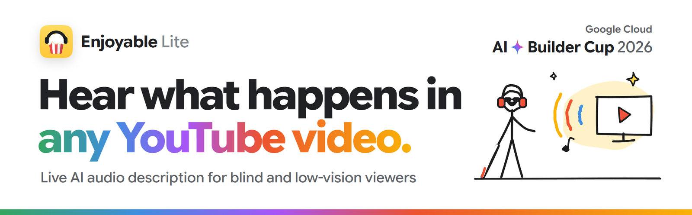
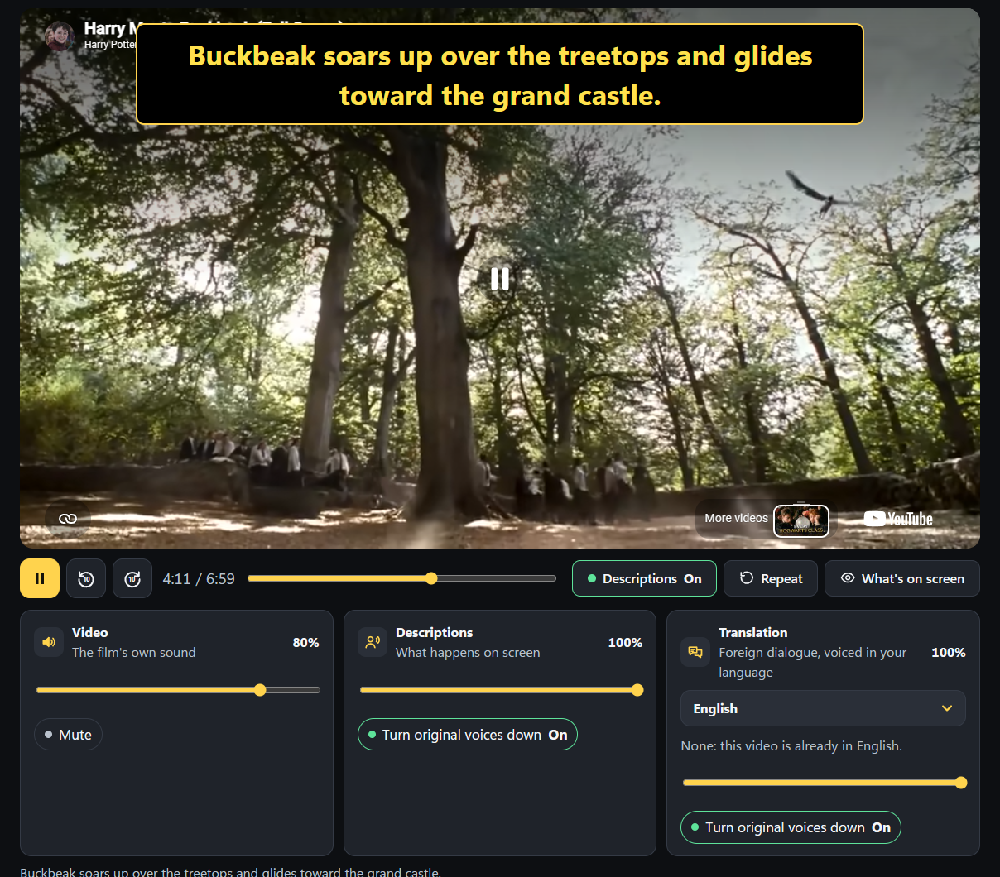
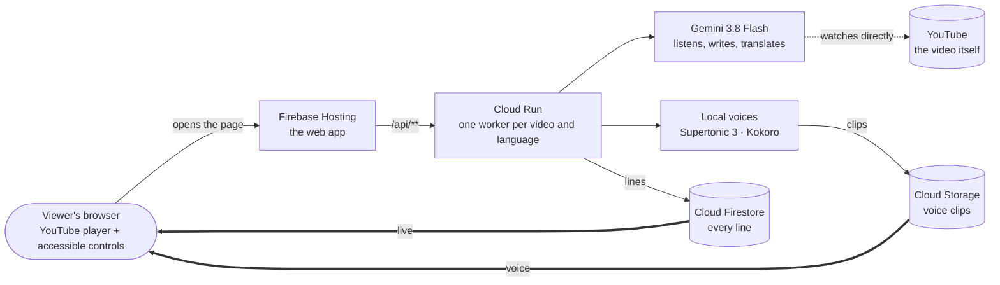
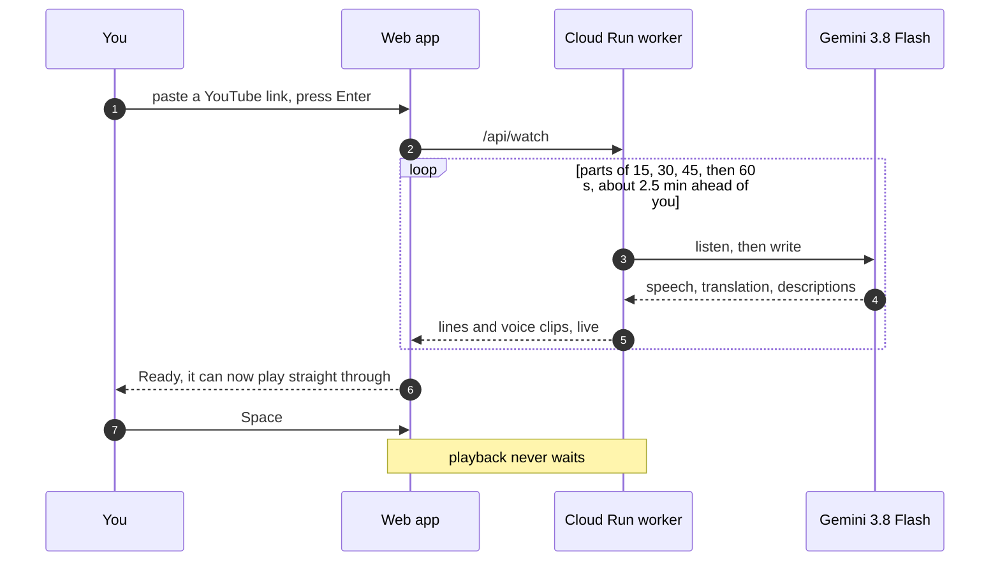
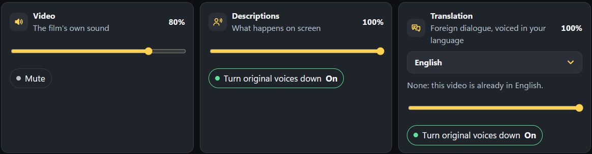

<p align="center">
  
</p>

<p align="center">
  <a href="https://enjoyable-lite.ables.com.my/"></a>
  <a href="https://drive.google.com/file/d/1l_DrDm_AzrMCWxicWDVGF5IvLc0H9Vvd/view?usp=sharing"></a>
  <a href="submission/ABLEs_Enjoyable-Lite_Deck_AI-Builder-Cup-2026.pdf"></a>
</p>

<p align="center">
  
  
  
  
  
  
  
  <a href="LICENSE.md"></a>
</p>

<p align="center"><sub>Google Cloud AI Builder Cup 2026 · Sustainability & Social Impact · team <b>ables.com.my</b></sub></p>

---

## The problem

About **27 million blind people live in Asia-Pacific**, six in ten of the world's total. For them a film is something
you hear: when people talk you can follow, but **when nobody speaks you are left guessing**.

Audio description closes that gap, but done professionally it costs **US$15–75 per minute**, so almost no online video
has it.

## The answer

Paste any YouTube link. **Gemini watches the video and describes what happens out loud, in the pauses between the
dialogue.** Dialogue in another language is translated and voiced in yours. It works on any video, live, for about
**US$0.016 a minute**, and every video it describes is instant and free for the next viewer.

<p align="center">
  
  <br><sub>A live description of <i>Harry Meets Buckbeak</i>, spoken in a pause and shown as a high-contrast caption.</sub>
</p>

| Feature | What it does |
|---|---|
| **Descriptions in the pauses** | One short line per silence, never over the dialogue; the video's sound fades down underneath and back up |
| **Translation (voice-over)** | Foreign dialogue voiced in your language, in a second voice, when it was said. Nothing to translate? It says *None* |
| **"What's on screen?"** | Ask at any moment (Ctrl+Shift+S) and hear the frame you are on |
| **Live, nothing prepared** | A brand-new video plays straight through in **under a minute**; the service keeps preparing ~2½ minutes ahead |
| **33 languages** | Natural voices, your system language by default |
| **Made for blind and low-vision viewers** | Keyboard first, spoken confirmations, screen-reader announcements, large high-contrast captions (≥ 7:1), ≥ 44 px targets |

## How it works



1. **Listen.** Gemini 3.8 Flash hears the next part of the video (in ~15 s pieces, in parallel): every line of speech,
   with its start, end, text, language and a translation.
2. **Find the silences.** Pauses of 2.2 s or more become gaps (0.6 s clear at each end; long ones split into slots of
   at most 10 s), each with a word budget.
3. **Write.** Gemini watches the same stretch and writes one line per gap, with the people and story so far as
   context. Code checks every line (no camera words, within its budget) and asks for one repair when needed.

   > **Note:** this repository ships a short, simplified description prompt (in `cloud/worker.py`) so that it runs
   > end to end. The production prompt behind the live site is not published, so descriptions from this code will
   > be plainer than on [enjoyable-lite.ables.com.my](https://enjoyable-lite.ables.com.my/).
4. **Voice.** Open-source voices on Cloud Run speak each line, fitted to its gap. Translated lines are voiced while the
   descriptions are being written.
5. **Deliver.** Lines stream to the page through Firestore; clips come from Cloud Storage. The page plays each one in
   its pause.

### Live, from the moment you press Enter



**"Ready" means ready to play through.** The page waits until enough is prepared that playback will never stop to
wait, and every part after that is ready before you reach it. When you leave, the worker stops after 90 s.

## Google Cloud

| Service | Role |
|---|---|
| **Gemini 3.8 Flash** | Hears and watches the YouTube video directly: speech timing, transcript, translation, descriptions, "what's on screen" |
| **Cloud Run** | The API and the preparation workers (2 vCPU, 4 GiB); runs the open-source voices; scales to zero |
| **Cloud Firestore** | Every line, streamed live to the page; the public can only read, only the service writes |
| **Cloud Storage** | The voice clips |
| **Firebase Hosting** | The web app, and the `/api/**` route to Cloud Run |
| **Secret Manager** · **Cloud Build** | The Gemini key · building the container |

## Cost and speed

Measured on the prototype:

| Measure | Result |
|---|---|
| **Gemini per minute of new video** (descriptions and translation) | **≈ US$0.016** · Gemini 3.8 Flash at US$0.75 in / US$3.75 out per million tokens |
| **A video someone already watched** | **US$0**: read, not made again |
| **Time until a new video plays straight through** | **under a minute** |
| **Preparation speed** | about **1.5× real time** (60 s of video in about 40 s) |
| **Cloud Run while preparing** | free tier, then ≈ US$0.16 an hour |

Against **US$15–75 a minute** for professional audio description, that is about **900× cheaper**. A daily spending
limit (`DAILY_LIMIT_USD`, default US$3) pauses new preparation when reached; videos already described keep working.

## Accessibility

Built for people who listen first:

- **Keyboard first.** Every action has a shortcut, and **F1** reads them all aloud.
- **Two ways to watch**, chosen on the first screen: *I listen* (the app speaks to you) or *I watch the screen*
  (large text, descriptions shown over the video).
- **Spoken and announced.** State changes are spoken in the app's own voice, and announced to screen readers without
  speaking twice.
- **Readable.** Dark, high contrast (text ≥ 7:1), one yellow accent that also marks keyboard focus, buttons ≥ 44 px,
  plain words, and native dropdowns that screen readers handle well.
- **Your sound, your way.** Separate volumes for the video, the descriptions and the translation, and your choice
  whether the original voices are turned down under each.

<details>
<summary><b>Keyboard shortcuts</b></summary>

| Keys | Action |
|---|---|
| Space or K | Play / pause |
| J / L | Back / forward 10 seconds |
| ↑ / ↓ | Video louder / softer |
| M | Mute or unmute the video |
| Ctrl+Shift+D | Descriptions on / off |
| Ctrl+Shift+R | Repeat the last description |
| Ctrl+Shift+S | Describe what is on screen now |
| Ctrl+Shift+↑ / ↓ | Descriptions louder / softer |
| Ctrl+, | Settings |
| F1 | Every shortcut, read aloud |

</details>

<details>
<summary><b>The sound controls</b></summary>

<p align="center"></p>

| Video | Descriptions | Translation |
|---|---|---|
| The film's own sound: volume and mute | What happens on screen: volume, and whether the original voices are turned down while a description plays | Which language (or Off), volume, and whether the original voices are turned down while a translated line plays |

The video's sound eases down over 200 ms when a voice starts and back up over 450 ms when it ends, so there is never an
audible jump.

</details>

## Run it yourself

<details>
<summary><b>Locally</b> (local files instead of Firestore)</summary>

```bash
python -m venv .venv
.venv/Scripts/pip install -r cloud/requirements.txt
echo GEMINI_API_KEY=your-key > .env
.venv/Scripts/python cloud/app.py
```

Open http://localhost:8080 (the server also serves `web/`). The two voices go in `models/`, the same files the
container downloads at build time (see [`cloud/Dockerfile`](cloud/Dockerfile)):

- **Supertonic 3** → `models/supertonic3/`: `onnx/`, `voice_styles/M1.json`, `voice_styles/F1.json` and `config.json`
  from [supertone-oss-archive/supertonic-3](https://huggingface.co/supertone-oss-archive/supertonic-3)
- **Kokoro (Chinese)** → `models/kokoro/`: `kokoro-v1.1-zh.onnx` and `voices-v1.1-zh.bin` from
  [kokoro-onnx model-files-v1.1](https://github.com/thewh1teagle/kokoro-onnx/releases/tag/model-files-v1.1), and
  `config.json` from [hexgrad/Kokoro-82M-v1.1-zh](https://huggingface.co/hexgrad/Kokoro-82M-v1.1-zh)

</details>

<details>
<summary><b>Deploy to Google Cloud</b></summary>

```bash
python cloud/stage.py
gcloud run deploy enjoyable-lite --source scratch/cloud_build --region asia-southeast1 \
  --memory 4Gi --cpu 2 --no-cpu-throttling --min-instances 0 --max-instances 1 --allow-unauthenticated \
  --set-env-vars GCP_PROJECT=<project>,BUCKET=<bucket>,GEMINI_BACKEND=apikey,DAILY_LIMIT_USD=3 \
  --set-secrets GEMINI_API_KEY=gemini-api-key:latest
firebase deploy --only hosting,firestore:rules --project <project>
```

</details>

<details>
<summary><b>Prepare videos in advance</b> (instant for everyone)</summary>

```bash
python cloud/prepare.py FsHWmOPa-44:en YIgT1jVD3TQ:en,ms,zh
```

Same pipeline as the service, straight into the same Firestore and Cloud Storage. Add `--fresh` to prepare again.

</details>

<details>
<summary><b>Repository layout</b></summary>

| Path | What |
|---|---|
| `web/` | The web app: `index.html`, `app.js`, `app.css`, `config.js` (plain HTML, CSS and JavaScript, no build step) |
| `cloud/app.py` | The API: `/api/watch`, `/api/heartbeat`, `/api/scene`, `/api/say`, `/api/usage` |
| `cloud/worker.py` | The preparation worker, with a simplified description prompt (the production prompt is not published) |
| `cloud/store.py` | Firestore and Cloud Storage (or local files for development) |
| `cloud/prepare.py` | Prepare whole videos in advance |
| `cloud/Dockerfile` · `cloud/stage.py` | The container (downloads the two voices at build time) · its build context |
| `firebase.json` · `firestore.rules` | Hosting with the `/api/**` rewrite · public read, server-only writes |
| `helper/tts.py` · `helper/supertonic_helper.py` | The open-source voices, each line fitted to its pause |
| `app/src/languages.json` · `web/languages.json` | The languages, for the service and for the page |
| `docs/assets/` | Images for this README |
| `submission/` | The pitch deck (PDF) |

</details>

## The Enjoyable family

| | **Enjoyable Lite** (this repo) | **Enjoyable Pro** | **Desktop edition** |
|---|---|---|---|
| For | Any YouTube video, **live** | Whole films and series, **preprocessed** | Any website, **offline** |
| How | Gemini 3.8 Flash on Google Cloud | The full agentic pipeline, with the published cast list for real character names | Gemma on the laptop's GPU or CPU |
| Voices | 33 languages, open-source voices | 130+ languages (Gemini 3.8 Flash TTS) | Open-source voices |
| Cost per minute | ≈ US$0.016 | ≈ US$0.08 | free |

## Privacy and safety

- No account, no login; your settings stay in your browser.
- The public can only **read** descriptions; only the Cloud Run service writes them ([`firestore.rules`](firestore.rules)).
- The Gemini key lives in Secret Manager, never in the page or the repository (`.env` is gitignored).
- Protected (DRM) video is never decrypted.

## License

Copyright (c) 2026 [ABLEs](https://www.ables.com.my). Licensed under the
[**PolyForm Noncommercial License 1.0.0**](LICENSE.md).

- **Free for non-commercial use:** personal use, research, schools, charities, blind and low-vision associations,
  public bodies and other noncommercial organisations may use, change and share this code.
- **Commercial use needs our permission.** Write to [info@ables.com.my](mailto:info@ables.com.my).
- The open-source voices keep their own licences (see Credits); the voice model files are not part of this repository.

## Credits

Open-source voices: [Supertonic 3](https://huggingface.co/supertone-oss-archive/supertonic-3)
(see [`helper/SUPERTONIC-LICENSE`](helper/SUPERTONIC-LICENSE)) and [Kokoro-82M](https://huggingface.co/hexgrad/Kokoro-82M)
(Apache-2.0). Clips from films and shows appear in the demo for demonstration only and belong to their owners.

---

<p align="center">
  <br>
  Made by <a href="https://www.ables.com.my"><b>ABLEs</b></a> · team <b>ables.com.my</b><br>
  <i>Here, we make dreams, we sell dreams.</i>
</p>
